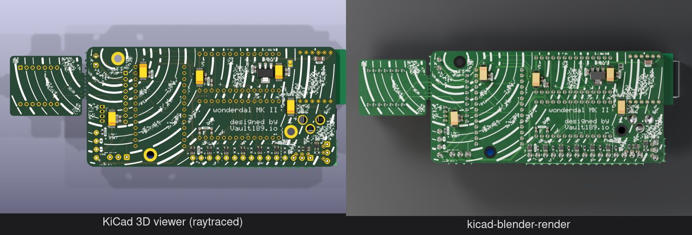
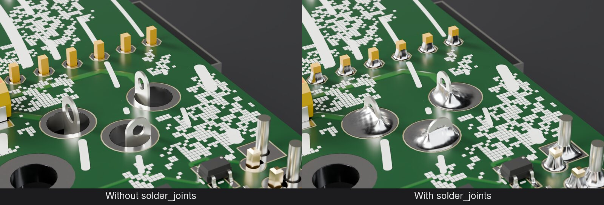
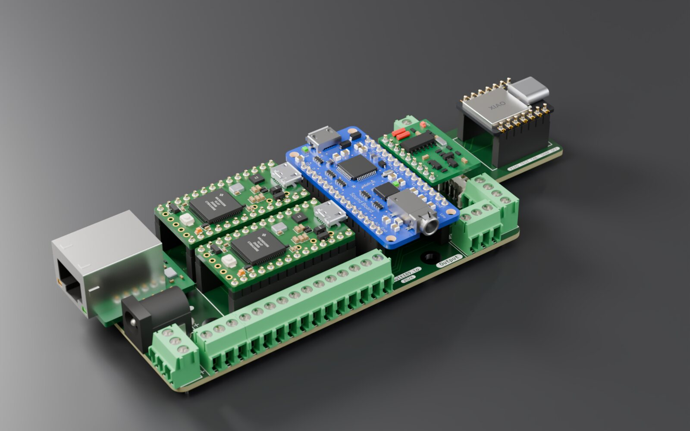
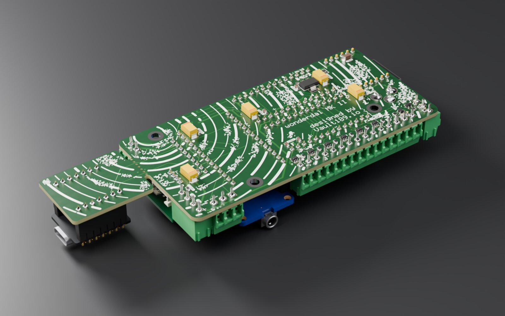
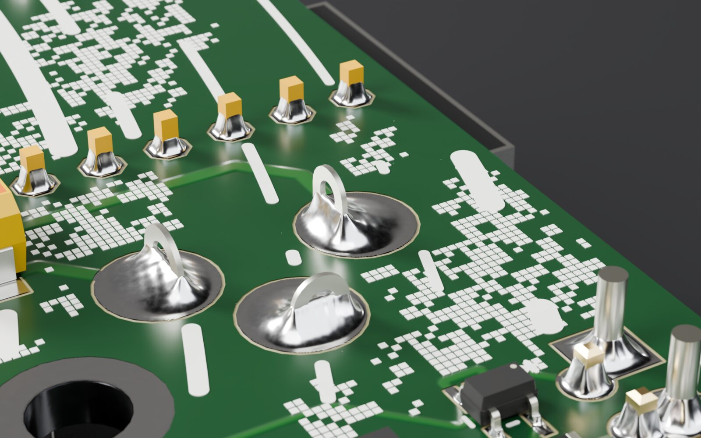
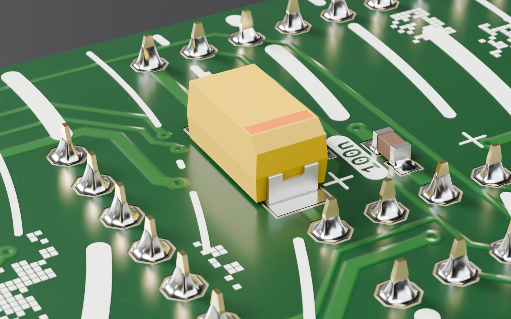
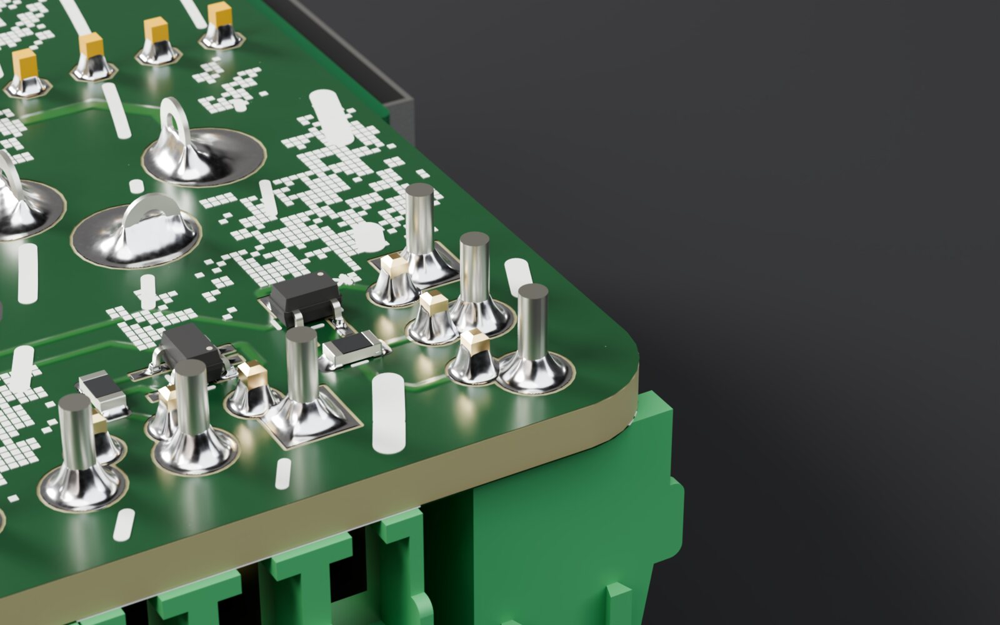

# kicad-blender-render

Photoreal renders of KiCad boards in Blender Cycles, with **generated solder joints**,
proper ENIG gold, glossy soldermask and studio lighting. One command, headless.

```sh
./pcb-render path/to/board.kicad_pcb --preset hero --side F
./pcb-render path/to/board.kicad_pcb --preset macro --focus U1 --samples 256
./pcb-render path/to/board.kicad_pcb --preset top --side B --backdrop light
```

Tested on a dozen real boards made with KiCad 6 to 10: dense SMD (0201/0402, QFN, LGA,
modules), through-hole heavy boards with plug-in modules, long LED strips, ENIG / HASL /
bare-copper finishes, black and green mask.

## Gallery

All shots: Wonderdal UDP IO (green mask, lead-free HASL, plug-in Teensy / Audio / Ethernet
modules), rendered on a laptop iGPU (Radeon 860M) with `--samples 256 --res 1920x1200`.





| | |
|---|---|
|  |  |
|  |  |



```sh
./pcb-render board.kicad_pcb --set standard --samples 256 --res 1920x1200   # these, for your board
```

### Shot sets and contact sheet

```sh
./pcb-render board.kicad_pcb --set standard --samples 128 --res 1920x1200
```

All shots render in **one Blender session**: the import, materials, copper relief and solder
are built once, then each shot just poses the board (front/back), places camera, lights and
backdrop, and renders. For your own list, pass `--shots shots.json` to `pcb-render`: a JSON list
of per-shot options (`preset`, `side`, `focus`, `zoom`, `azimuth`, `elevation`, `fstop`, `lens`,
`viewport`, `out`, `samples`, `res`, `backdrop`, `env_strength`, `exposure`); command-line options
are the defaults for every shot.

`scripts/shots.py` picks the shots from the board: hero and top views of both sides, a close-up
of the biggest IC on each side, and the solder side of the through-hole part with the most pins.
`--set quick` is just the two hero views. The renders are tiled (ImageMagick `montage`) into
`out/<board>/<board>_sheet_<set>.png`. Other options apply to every shot.

### KiCad button

`kicad_plugin/` is a PCB Editor action plugin. Install with
`ln -s ~/dev/kicad-blender-render/kicad_plugin ~/.local/share/kicad/10.0/scripting/plugins/pcb_render`,
then Tools → External Plugins → Refresh Plugins (toolbar icon appears). **KiCad 10 only loads
external Python plugins with the API on:** Preferences → Plugins → *Enable KiCad API*, then restart
KiCad (otherwise pcbnew silently skips them: "KiCad API is not enabled; external Python plugins
will not be available"). It asks for shot, side,
focus part (pre-filled from the selection), saved 3D viewport, quality and imperfection, then runs
`pcb-render` on the saved board in the background and opens the image when done
(log: `out/<board>/kicad-plugin.log`).

Several renders can run at once (KiCad button, batch sets, other terminals): exports of the
shared cache in `out/<board>/` are serialised with a lock and written to a temp file then renamed,
and the copper-relief cache is written the same way, so a render never reads a half-written file.

Output lands in `out/<board>/<board>_<preset>[-<ref>]_<side>.png` unless `--out` is given.


## How it works

1. **Export** (cached until the `.kicad_pcb` **or any 3D model it references** changes;
   `scripts/model_deps.py` resolves `${KIPRJMOD}`, `${KICADn_3DMODEL_DIR}`, your KiCad path
   variables and relative paths, and logs which file triggered a re-export):
   - `kicad-cli pcb export glb` with tracks, pads, zones, mask and silkscreen → board + 3D models.
   - `scripts/extract_pads.py` (KiCad's `pcbnew` Python) → every pad's exact outline, side,
     paste opening, THT/SMD, DNP, plus which footprints sit outside the board outline.
2. **Blender** (`scripts/render.py`):
   - Aligns KiCad mm coordinates to the GLB automatically (fit + ray-cast check, logged).
   - Hides footprints parked outside the board outline and removes their orphaned copper,
     mask and silk (`--keep-offboard` to keep them).
   - **Solder** (via the standalone [`solder_joints`](solder_joints/README.md) module): for each pasted pad it ray-casts into the component to find which pad points
     sit under a terminal/lead and how tall it is, then builds a heightfield joint: one concave
     meniscus from the terminal (~42 % of its height) down to zero at the pad edge, a thin
     wetting layer elsewhere (smooth-max blend), lightly smoothed like surface tension would.
     Solder only climbs **metal** (per-triangle material check): plastic bodies over a pad get
     the standoff gap filled (leadless QFN/DFN/LGA joints) but no climb; metal side flanks next
     to the pad get a small toe fillet.
   - **Silkscreen** gets real ink thickness (solidified down to the mask, ~25 µm, rounded edges).
   - **HASL** boards: bare pads and empty holes get a thin domed tin coating; big sheet-metal
     parts (shields, RJ45/USB shells) render satin.
   - Lighting: Poly Haven `studio_small_09` (CC0, fetched to `assets/hdri/`), `--hdri`, `--env-strength`.
   - **Mask**: each side's copper (tracks, pours, vias) is rasterised with Workbench, blurred
     and used as relief under the mask (also on the clear coat), plus orange peel, semi-gloss
     smudges and sparse dust. `PCB_RENDER_DEBUG_RELIEF=1` paints the relief map for checking. Pads with paste but no part get a reflowed dome; THT pins
     get a cone on both sides. Paste-only apertures (custom paste pads) count as paste.
   - Materials follow the board's stackup (`.kicad_pcb` layer colours + `copper_finish`):
     mask green/black/red/blue/white/yellow/purple or `#hex` (lighter shade over copper, as
     real translucent LPI mask), silkscreen white/black/yellow, finish ENIG / HASL /
     OSP-bare copper / immersion silver / immersion tin. Plus SAC solder and FR4 edges.
     Component STEP colours are reclassified (gold / tin-nickel metal / plastic / glass).
   - Lighting: Blender's bundled `studio.exr` plus four area lights, placed relative to the
     camera azimuth so none sits in the mask's mirror direction (no white glare patches).
   - Presets: `hero` (3/4 view), `low` (grazing), `macro` (close-up, use `--focus REF`),
     `top` (orthographic). Physical DOF; override with `--fstop`, `--azimuth`, `--elevation`.

   - Realism: `--imperfection 0..1` (default 0.6, `--seed N`) adds placement skew/offset on SMD
     parts, per-joint solder volume and lumpiness, frosty solder, mask smudges, ENIG and silk
     variation. `0` gives the clean CAD look.
   - Component fixes: STEP/WRL colours mapped to gold / tin / matte plastic / glass (tan nylon
     and ceramic bodies are kept as plastic). A model can ask for satin / bead-blasted nickel by
     using the exact STEP colour in `SATIN_METAL_RGB` (render.py), e.g. the magnetic connector's
     magnet ring, and normals re-derived (30° sharp edges) because
     many vendor models smooth across hard edges.
   - DOF: with `--focus`/macro the f-number is computed from the magnification so ~70 % of the
     frame width is sharp (focus-stacked look); hero f/32. `--zoom` tightens framing.

### Using a view from KiCad's 3D viewer

Set the view in KiCad's 3D viewer, save it as a named viewport, then save the project
(viewports live in the `.kicad_pro`, under `3dviewports`). Then:

```sh
./pcb-render board.kicad_pcb --viewport hero          # board framed automatically
./pcb-render board.kicad_pcb --viewport hero --zoom 0.6 --focus U5
```

Only the camera *direction and roll* come from KiCad; framing is fitted to the board (or the
`--focus` part) with `--zoom`/`--lens`, because KiCad's zoom/pan units don't map to a lens.
The matrix layout (row/column-major) is detected and logged.

Other options: `--samples`, `--res WxH`, `--exposure`, `--backdrop dark|light|none`
(none = transparent PNG), `--device auto|cpu|gpu`, `--no-solder`, `--save-blend file.blend`
(open the scene in Blender to tweak by hand).

## Blender on Fedora

`pcb-render` uses the official blender.org 5.2.2 build at
`~/.local/opt/blender-5.2.2-linux-x64/` if present (override with `BLENDER=…`), otherwise
the Fedora package. The official build bundles its own OCIO, so AgX works out of the box.
Neither build includes AMD's HIP runtime on Linux: install Fedora's ROCm
(`sudo dnf install --setopt=install_weak_deps=False rocm-hip rocm-runtime`, ~2.4 GB). With it,
the official build renders on the Radeon 860M (`--device auto` picks it):
1920×1200 @ 128 spp Wonderdal hero, render part only: **GPU 96 s, CPU 158 s, GPU+CPU 135 s**
(`--device both`; shared memory bandwidth makes it slower on this APU).

Fedora's `blender` 5.2.2 package (`sudo dnf install blender`) works, with two catches:

- It ships an OCIO 2.5 colour config but links OCIO 2.4, so AgX silently disappears and
  only "Standard" (harsh clipping) is left. `pcb-render` fixes this by generating a patched
  copy in `ocio/` (2.5-only keys stripped) and pointing `OCIO` at it. System files untouched.
- No HIP (AMD GPU) runtime, so Cycles renders on the CPU. Fine for previews:
  1280×800 @ 64 spp ≈ 25 s, 1920×1200 @ 128 spp ≈ 100 s on a Framework 13 laptop (Ryzen AI 7 350).

The official build is also the same version the Windows render boxes should run (there
the Windows build does ship HIP support for Radeon cards).

## Plan: remote GPU renders

Final renders on the 9070 XT / 7800 XT Windows machines: wake, copy `out/<board>/`
+ `scripts/render.py` over SSH, run the same Blender version with `--device gpu`, copy
the PNG back. Not built yet; needs OpenSSH server on the Windows box.

## Known limits

- Solder shape is heuristic (heightfield per pad), not a fluid simulation. BGA balls and
  bottom-terminated pads under a body are hidden anyway.
- Fillet height follows the part's 3D model; odd models (e.g. tall end caps) look odd.
- Copper under the mask isn't visible as relief (mask is flat in KiCad's export).

## Licence

- **This project** (pipeline, materials, presets, shot sets, KiCad plugin):
  [PolyForm Noncommercial 1.0.0](LICENSE). Use it, change it, share it; not for money, and keep
  the notice line: `Required Notice: Copyright Chris Fourie (https://github.com/No1089)`.
  It is not an OSI open-source licence.
- **`solder_joints/`** (the solder joint generator): **LGPL-3.0-or-later**, see
  [solder_joints/README.md](solder_joints/README.md). Kept separate and copyleft so it can be
  offered to other tools (e.g. pcb2blender, GPL-3.0) and used by this non-commercial project
  without licence conflicts.

